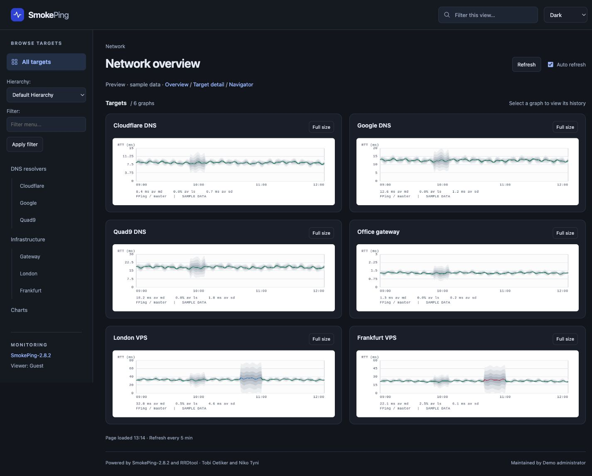

# SmokePing Atlas

Atlas is a responsive theme for **SmokePing 2.8.2+ds-1 on Ubuntu 24.04 (Noble)**, including ARM VMs. It uses SmokePing's supported HTML template and existing CGI output. No recompilation, Perl patches, database changes, or frontend build step are required.

## Features

- White, dark, and system appearance, remembered in the browser. Inline startup colors and appearance setup establish the background before external assets load, including on target detail navigation.
- A target sidebar on desktop and a keyboard-accessible drawer on phones.
- An overview grid for the targets in the current SmokePing section, with a local graph filter.
- Native target, hierarchy, slave, charts, and navigator links.
- Full-size graph dialogs for reading the original PNG labels on small screens.
- Configured history ranges derived from the generated page, including separate slave graphs.
- Auto refresh at SmokePing's configured step. It pauses in the navigator, hidden tabs, open dialogs, open mobile navigation, and while editing or filtering.
- Print styling and basic graph/navigation access with JavaScript disabled.
- An installer with dry-run, configuration validation, backups, and rollback.

**The optional Atlas renderer adds themed PNGs and real RRD statistics.** It runs on demand through your web server, using Python 3, a small Perl configuration adapter, and RRDtool. SmokePing continues collecting measurements. Without the renderer, Atlas displays native PNGs on white surfaces.



[White desktop preview](docs/screenshots/atlas-desktop-white.jpg) · [Mobile preview](docs/screenshots/atlas-mobile-dark.jpg)

Nested groups show their graphs when you enter that group. Atlas does not crawl other sections or invent a global monitoring API. The header filter affects graphs currently displayed; SmokePing's sidebar filter remains its separate native server-side filter.

## Install on your Ubuntu VM

Copy this repository, or extract the release archive, onto the VM. Run these commands **inside that copy on Ubuntu**, not on your Mac:

```sh
# Review the exact files and configuration changes first.
sudo python3 tools/install.py install --dry-run

# Install and validate with smokeping --check.
sudo python3 tools/install.py install

# Apply the presentation configuration.
sudo systemctl reload smokeping
```

For Apache installations using persistent FastCGI workers, also reload Apache so those workers pick up the new configuration:

```sh
sudo systemctl reload apache2
```

Open your existing SmokePing URL. Installed CSS, scripts, and their module imports use a shared content hash in their URLs so browser/CDN caches refresh when the theme changes. The default Ubuntu paths are:

| Purpose | Path |
| --- | --- |
| Presentation configuration | `/etc/smokeping/config.d/Presentation` |
| Atlas template | `/etc/smokeping/atlas/basepage.html` |
| Atlas assets | `/usr/share/smokeping/www/atlas/` |
| Public asset URL | `/smokeping/atlas/` |
| Backups | `/var/backups/smokeping-atlas/<backup-id>/` |

The installer changes only the `template` and `htmltitle` settings in the root Presentation section. It preserves graph sizes, ranges, probes, targets, alert settings, and all RRD files. Your original `/etc/smokeping/basepage.html` and packaged CSS/JavaScript files are retained. The installer prints a backup ID and automatically restores previous files if configuration validation fails.

Keep the installer/release folder and the printed backup ID for rollback. Backups may contain configuration data; the installer stores their files privately.

### Enable themed graphs

Install the renderer alongside the theme on Ubuntu:

```sh
sudo apt install rrdtool
sudo python3 tools/install.py install --with-renderer --dry-run
sudo python3 tools/install.py install --with-renderer
sudo a2enmod cgid
sudo a2enconf smokeping-atlas
sudo apache2ctl configtest
sudo systemctl reload apache2
sudo systemctl reload smokeping
```

This adds an on-demand CGI executable, **not a continuously running service**. No SmokePing recompilation or RRD migration is needed. The installer checks that the full SmokePing configuration can be read by `www-data` and creates a private cache owned by that account. Existing packaged Perl modules, CGI scripts, and RRD databases remain unchanged.

| Renderer component | Installed location |
| --- | --- |
| Python CGI | `/usr/lib/cgi-bin/smokeping-atlas.cgi` |
| Perl configuration adapter | `/usr/share/smokeping-atlas/catalog.pl` |
| Renderer settings | `/etc/smokeping/atlas/renderer.json` |
| Apache mapping | `/etc/apache2/conf-available/smokeping-atlas.conf` |
| PNG and metadata cache | `/var/cache/smokeping-atlas/` |
| Default endpoint | `/smokeping/atlas-graph.cgi` |

The Apache mapping must execute the file as CGI. For Nginx, route this endpoint through your existing CGI runner (such as `fcgiwrap`) with `SCRIPT_FILENAME=/usr/lib/cgi-bin/smokeping-atlas.cgi`; a static file mapping is insufficient. The renderer requires read access to the same configuration and RRDs as SmokePing's web frontend, and write access only to its dedicated cache.

If SmokePing has authentication or IP restrictions, apply the **same access policy to `/smokeping/atlas-graph.cgi`** before enabling it. The supplied mapping adds no `Require all granted` directive and does not copy per-file or per-URL authentication rules. A policy covering the entire `/smokeping/` URL subtree can cover both endpoints.

Use `--renderer-url /monitor/atlas-graph.cgi` and `--smokeping-config /etc/smokeping/config` for a custom endpoint or full configuration file. `--presentation` selects the presentation section file; `--smokeping-config` selects the complete configuration including its includes. All paths in `renderer.json` are server-controlled; requests cannot supply database paths or executable names.

Open this URL to verify the endpoint, substituting one of your real target names:

```text
/smokeping/atlas-graph.cgi?target=DNS.Cloudflare&theme=dark&width=640&height=240&format=json
```

It returns graph statistics, plot geometry, and an `image_query`. Request that exact query on the same endpoint to retrieve the PNG. Atlas does this automatically and switches graphs when White/Dark/System changes. It requests bounded size buckets and 1×/2× resolution for mobile and Retina screens; drag-to-zoom uses actual RRDtool plot coordinates.

The renderer supports individual latency targets and their configured slaves. Alternate hierarchies, group aggregates, multi-host comparisons, and probes whose units are not seconds retain native graphs. Failed endpoint requests fall back to their original PNG with a visible message. With JavaScript disabled, all graphs remain native. Renderer-enabled installs request only Atlas PNGs for supported graphs. The installer selects `renderer-first` loading and keeps native markup in inert templates, so the browser does not download native PNGs before JavaScript runs. Native URLs are activated only for unsupported graphs or when Atlas metadata/image loading fails or times out. If the frontend module fails to load, a small bootstrap restores native images after ten seconds. JavaScript-disabled browsers receive native graphs directly. SmokePing still generates native PNGs while producing its CGI page; avoiding that server-side work would require a separate change to the page generator.

The blue median line and nested translucent bands use real `median` and sorted `pingN` RRD data, expressed in milliseconds. Packet-loss thresholds follow SmokePing's default count thresholds, or your configured `detail/loss_colors`; zero loss uses the theme's blue accent by default. Total loss remains visible when the median is unknown, and missing measurements have separate gray shading. Expand the legend to inspect loss colors. Times are UTC.

Statistics are computed from the same consolidated series and interval as the PNG. `Last median` means the last non-missing median in that interval; it is not a health indicator or the probe's latest collection timestamp. `Avg median` and `Max median` describe median latency, not the slowest individual ping. Historical consolidation and graph resolution can affect these values. A range with recorded 100% loss and no latency displays **No replies**, while retaining the measured loss percentage and red outage shading. Recorded loss with missing latency displays **No latency**. **No data** is reserved for missing values, with a range message distinguishing absent measurements from failed replies. Total packet loss alone does not determine whether the host is offline or is filtering probes.

The cache keys include target/slave, theme, time interval, dimensions, scale, configuration metadata, and the RRD's stored last-update timestamp. PNG tokens bind images to their metadata even if a probe updates between requests. One lock limits concurrent rendering; commands have timeouts. Old graphs are pruned on render requests, keeping at most 256 pairs and approximately 128 MiB of PNGs. The parsed target catalog expires after 30 seconds, including for configuration changes in included files.


[White mobile renderer preview](docs/screenshots/atlas-renderer-mobile-white.jpg). These screenshots use synthetic measurements in real RRD files, not your VM's monitoring data.

To disable the endpoint before restoring an installation backup:

```sh
sudo a2disconf smokeping-atlas
sudo python3 tools/install.py restore YOUR_BACKUP_ID
sudo apache2ctl configtest
sudo systemctl reload apache2
sudo systemctl reload smokeping
```

Rollback restores managed files. It retains the dedicated generated cache directory and backup; the cache contains derived PNGs and target metadata, not source RRDs. Disable the Apache configuration before rollback if that installation introduced it.

### Native graphs after a renderer upgrade

If the renderer endpoint returns JSON but graphs remain native without a fallback message, the browser may still be running an older `atlas.js` from its cache. The installer versions the CSS, scripts, and imported modules together with a content hash to prevent mismatched upgrades. Reinstall using the updated installer, then reload the page. For an older installation, purge cached `/smokeping/atlas/` assets at your CDN and perform a hard refresh or clear the site's browser cache. Restarting Nginx or SmokePing does not clear those caches.

For Cloudflare cache rules, preserve query strings in the cache key for Atlas's static files and bypass caching for `/smokeping/atlas-graph.cgi`. The endpoint already emits `Cache-Control: private, max-age=0, must-revalidate`.

### Installing from a root-owned checkout

The installer and catalog helper use `/` as their working directory when loading probes. SmokePing's probe base adds a relative `..` Perl module search path; inheriting a checkout under `/root` can otherwise produce `../IPC/Open3.pm: Permission denied` after switching to `www-data`.

If using an earlier installer that reports this error, retry from `/` with the installer’s absolute path:

```sh
cd /
python3 /root/SmokePingModernTheme/tools/install.py install --with-renderer
```

The failed installation restores managed files automatically. This workaround does not require changing `/root` permissions or reinstalling Perl modules.

### Custom configuration or web alias

```sh
sudo python3 tools/install.py install \
  --presentation /etc/smokeping/config.d/Presentation \
  --assets-url /monitor/smokeping/atlas
```

`--assets-url` is a URL path, not a filesystem path. Its parent should be your SmokePing static asset alias, which must also serve the existing `js/` directory. The default Ubuntu Apache configuration already maps `/smokeping` to `/usr/share/smokeping/www`. Nginx or custom proxy installations need an equivalent static mapping.

Drag-to-zoom uses the installed package libraries at `js/prototype/prototype.js`, `js/scriptaculous/{builder,effects,dragdrop}.js`, and `js/cropper/cropper.js`. Atlas loads them only in the navigator. If those assets are unavailable, the native start/end form still works and a visible hint explains the missing drag feature.

The installer keeps your current graph dimensions. For a more compact overview, you can optionally adjust the existing `+ overview` section to `width = 360` and `height = 100`. This changes presentation only; choose dimensions that keep your configured legends readable. Mobile users can always use **Full size** to inspect the original graph labels.

If your `smokeping` executable is outside sudo's PATH, fix PATH or run a deliberate staged/manual installation with `--skip-config-check`, then validate on the VM with `sudo smokeping --check` before reloading.

### Roll back

Use the ID printed during installation:

```sh
sudo python3 tools/install.py restore YOUR_BACKUP_ID --dry-run
sudo python3 tools/install.py restore YOUR_BACKUP_ID
sudo systemctl reload smokeping
# Also reload Apache if you use persistent FastCGI workers.
sudo systemctl reload apache2
```

Restoration recovers the previous configuration and any pre-existing Atlas files, and removes only the new files tracked by that installation. It retains the backup itself. If you install twice, restore the newest backup first to return to the preceding installation.

## Local preview

Requires Node.js 18+; no npm dependencies or installation are needed:

```sh
npm run preview
```

Visit [the local preview](http://127.0.0.1:8787/smokeping/smokeping.cgi). The preview renders the actual Atlas template with **synthetic fixtures matching SmokePing 2.8.2's generated HTML structure**. Its sample PNGs are illustrations, not measurements from your VM. Links provide overview, target detail, and navigator views.

The preview's native start/end form works without third-party libraries. To check drag-to-zoom against an installed SmokePing asset directory:

```sh
npm run preview -- --native-www /usr/share/smokeping/www
```

Other useful preview cases are `?target=_charts`, `?target=Empty`, `?target=Waiting`, `?target=Broken`, `?nojs=1`, and `?target=DNS.Cloudflare~remote;hierarchy=location`. The `nojs` fixture omits the page scripts so the progressive HTML/CSS fallback can be checked.

## Verification and release

```sh
npm run check
npm test
npm run package
```

The tests include real RRD/PNG integration when `rrdtool` is on PATH, cache reuse/invalidation, Retina geometry, unknown data, catalog traversal/slaves, CGI parameter preservation, time-to-pixel zoom mapping, installer backups/rollback, configuration-check failure, file permissions, custom aliases, and traversal/symlink rejection. The release archive is written to `dist/smokeping-atlas-1.1.0.tar.gz`; it includes the theme, renderer, installer, README, screenshots, and license, and excludes demo data and development tools.

Browser checks should cover desktop and 320/390/768 px widths, both appearances, target navigation, filtering, full-size dialogs, keyboard/Escape behavior, navigator time-range submission and cropping, missing graph images, and no-JavaScript navigation. These can validate the theme locally; the final installation and real RRD rendering still need to be checked on your VM.

After installing, confirm:

1. `sudo smokeping --check` passes and `/smokeping/atlas/atlas.css` returns CSS.
2. Real graphs load, rendered statistics and loss colors match your expected data, and full-size view works.
3. Target, hierarchy, slave, and charts links retain their parameters.
4. Clicking a detailed graph opens the navigator; submitting start/end updates its range.
5. White/dark/system choice survives a reload, and mobile navigation closes with Escape.

For a local preview of the actual optional renderer, install RRDtool in your development environment, then:

```sh
python3 tools/renderer-preview.py .preview/renderer --create
npm run preview -- --renderer-fixtures .preview/renderer
```

For request/fallback checks, add `--log-requests`, `--fail-renderer-png`, `--fail-graph-module`, or `--fail-styles` to the preview command. A successful renderer-first page should request no `/smokeping/images/` PNGs.

This development-only bridge uses a synthetic target catalog and real synthetic RRDs. Production CGI always resolves targets through the installed SmokePing parser; it has no fixture override. The catalog adapter is tested with a controlled configuration stub; the final full parser/probe check runs on Ubuntu during installation. Local real-RRD integration was verified with RRDtool 1.11.0; Ubuntu Noble's RRDtool and your actual probes still require the VM smoke check.

To regenerate synthetic PNG fixtures, install Pillow in your development environment and run `python3 tools/generate-fixtures.py`. Pillow is not required by the theme, installer, tests, or preview.

## Compatibility references

- [Ubuntu Noble package](https://packages.ubuntu.com/noble/smokeping)
- [Upstream SmokePing 2.8.2 template and renderer](https://github.com/oetiker/SmokePing/tree/2.8.2)
- [SmokePing template configuration](https://oss.oetiker.ch/smokeping/doc/smokeping_config.en.html)

The exact Noble package was inspected to confirm its template fields, native menu/graph markup, static aliases, and existing dependency paths. This repository contains no redistributed SmokePing or third-party JavaScript libraries; they retain their own licenses in the installed distribution.
