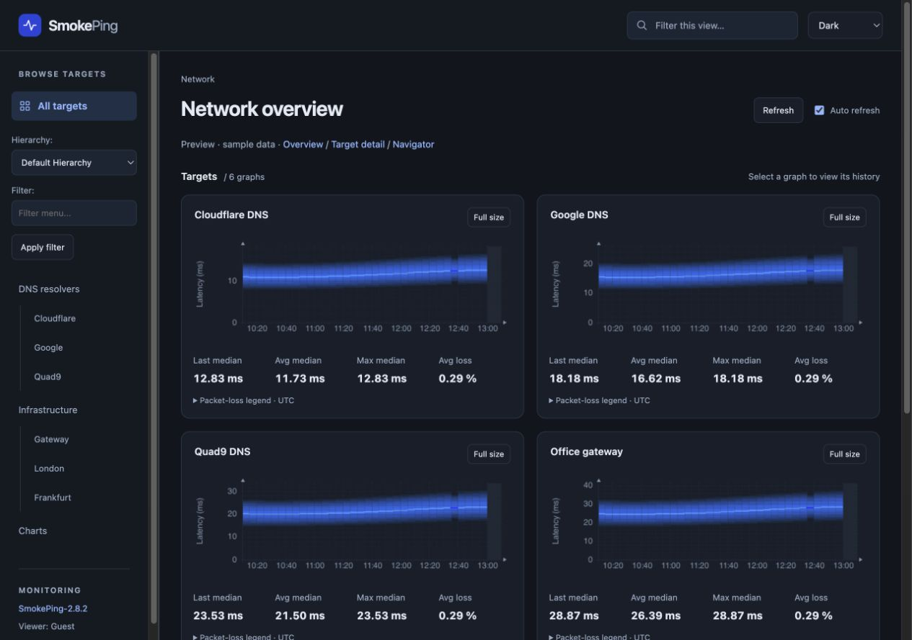

# SmokePing Atlas

A responsive theme for SmokePing with white, dark, and system appearance, mobile navigation, and matching latency graphs.

Tested with **SmokePing 2.8.2+ds-1 on Ubuntu 24.04**, including ARM systems. No SmokePing rebuild or database migration is required.



[White mobile preview](docs/screenshots/atlas-renderer-mobile-white.jpg) · [Download a release](https://github.com/LookedPath/SmokePingModernTheme/releases/latest)

Screenshots use sample data.

## Features

- White, dark, or automatic appearance, remembered between visits.
- Responsive target navigation and graph layouts for desktop and mobile.
- Themed graphs with latency and packet-loss statistics.
- Graph zooming, history ranges, and full-size views.
- Filtering of the graphs in the current view and automatic refresh.
- Standard SmokePing graphs as a fallback, plus installation backups and rollback.

The themed graphs are optional. They support individual latency targets and their configured slaves; other graph types use SmokePing's standard graphs.

## Install

Start with a working SmokePing installation. Download and extract a [release](https://github.com/LookedPath/SmokePingModernTheme/releases/latest), or clone the repository:

```sh
git clone https://github.com/LookedPath/SmokePingModernTheme.git
cd SmokePingModernTheme
```

Run the following **on your SmokePing server**, inside the repository or extracted release folder:

```sh
sudo apt install python3 rrdtool
sudo python3 tools/install.py install --with-renderer --dry-run
sudo python3 tools/install.py install --with-renderer
sudo systemctl reload smokeping
```

The dry run shows the planned changes. Installation checks the configuration, saves a backup, and prints the backup ID. Keep that ID and the installer folder for rollback.

Next, follow the **Nginx** or **Apache** instructions below to enable the themed graphs. For the layout alone, omit `--with-renderer`; RRDtool and the extra graph endpoint are then unnecessary. Keep your existing web-server configuration and reload Apache if you use it. Node.js is only needed for development.

### Nginx

Atlas uses the same CGI runner as SmokePing. On Ubuntu, install and start `fcgiwrap` if it is not already available:

```sh
sudo apt install fcgiwrap
sudo systemctl enable --now fcgiwrap.socket
```

In the Nginx `server` block serving SmokePing, use these locations. Replace existing SmokePing locations rather than creating duplicates, and keep your current domain and HTTPS settings.

```nginx
# Existing SmokePing page.
location = /smokeping/smokeping.cgi {
    include /etc/nginx/fastcgi_params;
    fastcgi_param SCRIPT_FILENAME /usr/lib/cgi-bin/smokeping.cgi;
    fastcgi_pass unix:/var/run/fcgiwrap.socket;
}

# Atlas themed graphs.
location = /smokeping/atlas-graph.cgi {
    include /etc/nginx/fastcgi_params;
    fastcgi_param SCRIPT_FILENAME /usr/lib/cgi-bin/smokeping-atlas.cgi;
    fastcgi_pass unix:/var/run/fcgiwrap.socket;
    fastcgi_intercept_errors off;
    fastcgi_read_timeout 60s;
}

# SmokePing images and theme assets.
location ^~ /smokeping/ {
    alias /usr/share/smokeping/www/;
    index smokeping.cgi;
    gzip off;
}
```

For a layout-only installation, omit the Atlas graph location. If your existing `fcgiwrap` socket has a different path, use it in both `fastcgi_pass` lines. The renderer expects `fcgiwrap` to run as `www-data`, Ubuntu's default account. If you restrict access to SmokePing, apply the same authentication or IP rules to the Atlas graph endpoint.

Validate the configuration and reload Nginx:

```sh
sudo nginx -t && sudo systemctl reload nginx
```

Open `/smokeping/smokeping.cgi` on your domain and select a target group. Nginx users can ignore the Apache activation commands printed by the installer.

For reference: [Nginx FastCGI configuration](https://nginx.org/en/docs/http/ngx_http_fastcgi_module.html#fastcgi_param).

### Apache

With the theme and renderer installed, enable the supplied configuration:

```sh
sudo a2enmod cgid
sudo a2enconf smokeping-atlas
sudo apache2ctl configtest && sudo systemctl reload apache2
```

Apply any existing SmokePing authentication or IP rules to `/smokeping/atlas-graph.cgi` as well. Open your usual SmokePing URL and select a target group.

### Custom paths

The defaults are `/etc/smokeping/config` for the full configuration, `/etc/smokeping/config.d/Presentation` for presentation settings, and `/smokeping/atlas` for public theme assets.

Use `--smokeping-config`, `--presentation`, `--assets-url`, or `--renderer-url` to change them. Your web-server locations must match any custom URLs. See all options with:

```sh
python3 tools/install.py install --help
```

## Updates and rollback

To update, extract the latest release and run the installer again with the same options, then reload SmokePing and refresh the browser. Keep `--with-renderer` if you use themed graphs.

To restore a previous installation, replace `BACKUP_ID` with the ID printed by the installer:

```sh
sudo python3 tools/install.py restore BACKUP_ID --dry-run
sudo python3 tools/install.py restore BACKUP_ID
sudo systemctl reload smokeping
```

Backups are stored in `/var/backups/smokeping-atlas/`. Restore the most recent backup first if you have installed multiple times.

If you are removing the renderer, remove its Nginx location and validate/reload Nginx before restoring. For Apache, run `sudo a2disconf smokeping-atlas` before restoring and validate/reload Apache afterward.

## Graphs and troubleshooting

Themed graph times use **UTC**. Latency statistics describe median latency over the selected range; **Last median** is the last available median in that range.

| What you see | What to check |
| --- | --- |
| **No replies** | Measurements record 100% packet loss. Check the target and probe; this alone does not prove the host is offline. |
| **No latency** | Probe measurements exist, but latency values are unavailable for this range. |
| **No data** | Try another range and check that SmokePing is collecting measurements. |
| **Native graph · Atlas renderer unavailable** | Check the graph endpoint, the web-server error log, and `fcgiwrap` permissions. |
| Old appearance after an update | Refresh the browser and clear stale site/CDN assets. CDN cache rules must preserve query strings for theme files and bypass the graph endpoint. |
| Nginx returns **502** | Check `fcgiwrap.socket` is active and its path and permissions allow Nginx to connect. |

To check the renderer directly, replace `YOUR.GROUP.Target` with a target from your configuration:

```text
https://YOUR_DOMAIN/smokeping/atlas-graph.cgi?target=YOUR.GROUP.Target&theme=dark&format=json
```

A working endpoint returns graph information and statistics. The installer preserves your probes, targets, alerts, and RRD files.

## Development

For a local preview, install Node.js 18+ and run `npm run preview`. Development instructions and implementation notes are in the repository’s [AGENTS.md](https://github.com/LookedPath/SmokePingModernTheme/blob/main/AGENTS.md).

## License

[MIT](LICENSE).
